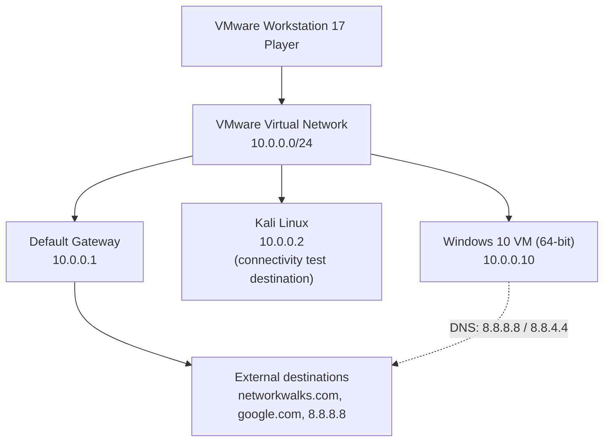
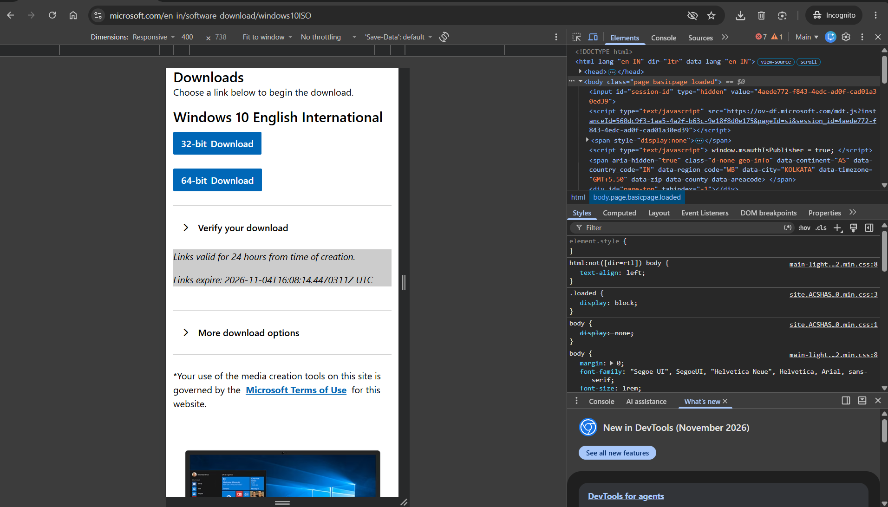
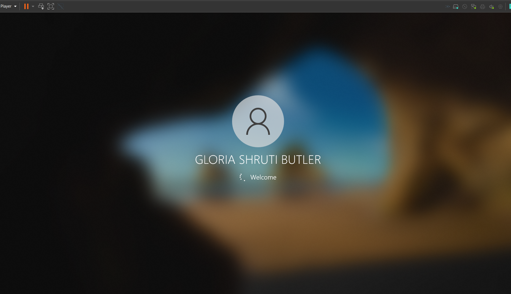
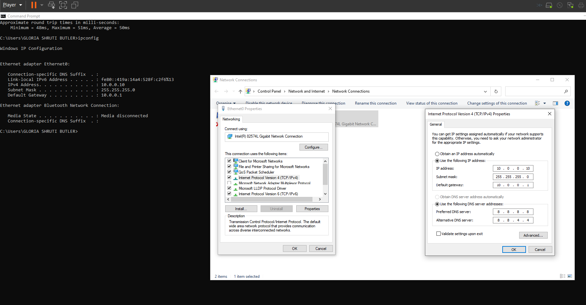
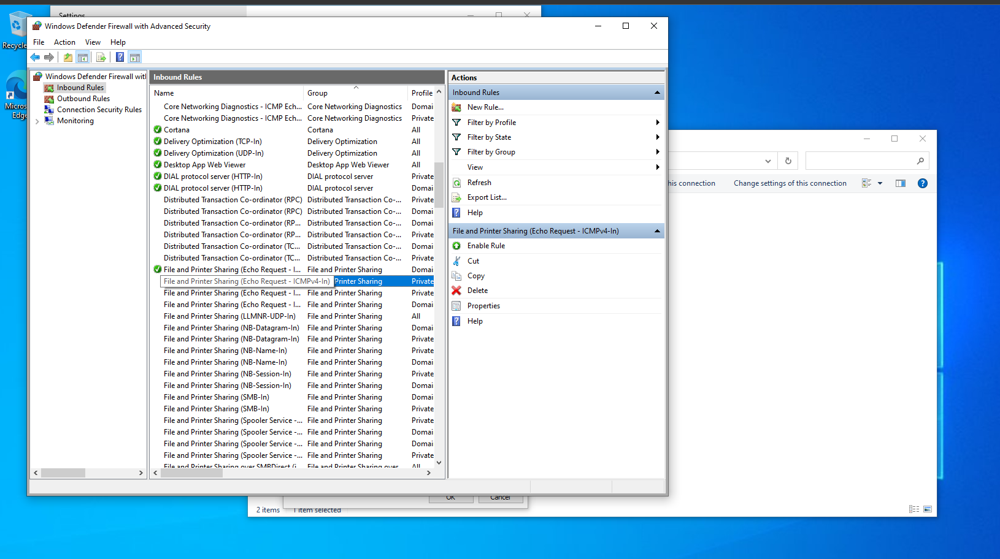
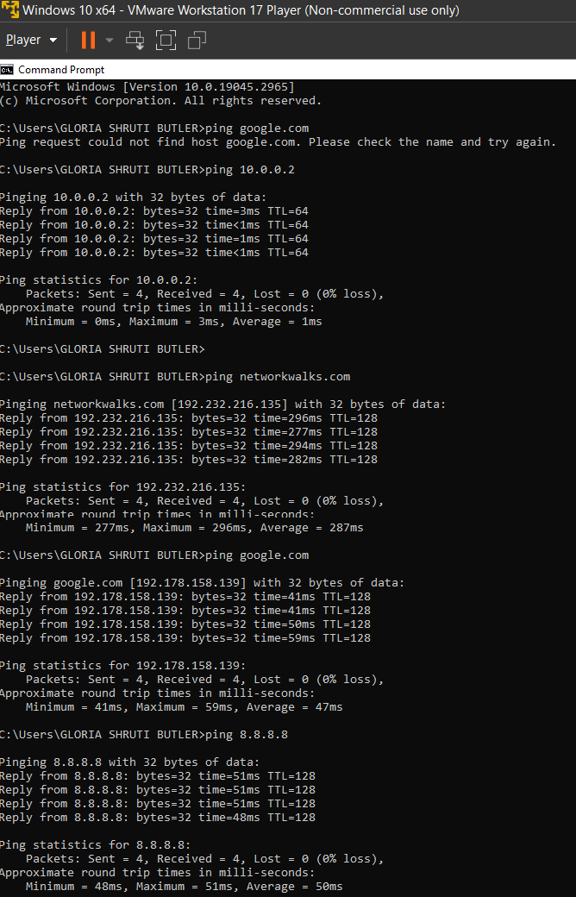

<div align="center">

# 🪟 Windows 10 Virtual Machine Setup and Network Configuration

### Windows 10 virtualization, static IPv4 configuration, firewall ICMP settings, and connectivity testing in a cybersecurity lab


**NetworkWalks Cybersecurity Program · Batch B084J · Week 01 · Project Module 1**

</div>

---

## 📖 Project Overview

This repository documents my **Windows 10 virtual machine setup and network configuration** project for **Project Module 1 – Cybersecurity Lab Setup** in the NetworkWalks Cybersecurity Internship (Batch B084J, Week 01).

**What the project is about:** I ran a Windows 10 (64-bit) virtual machine in **VMware Workstation 17 Player**, gave it a static IPv4 configuration, reviewed a Windows Firewall rule for ICMP echo requests, and tested connectivity with `ipconfig` and `ping`.

**Why Windows 10 in a virtual machine:** A VM lets me run a full Windows system inside my own computer without changing the host. It is isolated, easy to manage, and suitable for learning.

**How the static IP was configured:** Instead of relying on automatic IP assignment, I entered the IPv4 address, subnet mask, default gateway and DNS servers manually in the Windows Network Connections settings.

**How Kali Linux was used:** My lab also contains a separate Kali Linux system at `10.0.0.2`. In this project it is only a **connectivity test destination**. The main subject here is Windows 10.

**How connectivity was tested:** From the Windows Command Prompt I pinged the Kali Linux system, two domain names, and a public IP address.

| | |
|---|---|
| 👩‍💻 **Author** | Gloria Shruti |
| 🖥️ **Guest OS** | Windows 10 (64-bit) |
| 🧰 **Virtualization** | VMware Workstation 17 Player |
| 🌐 **Network Config** | Static IPv4 on `10.0.0.0/24` |

---

## 🎯 Project Objectives

- ✅ Set up a Windows 10 virtual machine
- ✅ Understand the basics of virtualization
- ✅ Configure a static IPv4 address
- ✅ Configure the default gateway and DNS servers
- ✅ Understand the role of Windows Firewall ICMP rules
- ✅ Test communication between Windows 10 and Kali Linux
- ✅ Verify connectivity to external IP addresses and domain names

---

## 🧪 Purpose of the Lab

A Windows environment is useful in a cybersecurity lab because most real-world networks include Windows systems. Learning how Windows handles networking, firewall rules and name resolution is a basic skill for security work.

Using Windows 10 together with Kali Linux helps me understand:

- 🌐 How networking works between two operating systems
- 🔄 How operating systems communicate with each other
- 🛠️ How to troubleshoot basic connectivity problems

> ⚠️ This is an educational lab. It is meant for learning and authorized testing only.

---

## 🏗️ Lab Architecture

The Windows 10 virtual machine runs inside **VMware Workstation 17 Player** and connects to a **VMware virtual network**. The Kali Linux system is on the same `10.0.0.0/24` network. Traffic to external destinations goes through the default gateway `10.0.0.1`.



> The specific VMware network identifier is not shown in the supplied screenshots, so it is described here only as the configured VMware virtual network.

---

## ⚙️ Lab Configuration

| Component | Configuration |
|---|---|
| Hypervisor | VMware Workstation 17 Player |
| Guest Operating System | Windows 10 (64-bit) |
| IPv4 Address | `10.0.0.10` |
| Subnet Mask | `255.255.255.0` |
| Default Gateway | `10.0.0.1` |
| Preferred DNS | `8.8.8.8` |
| Alternate DNS | `8.8.4.4` |
| Kali Linux IP | `10.0.0.2` |
| Network Range | `10.0.0.0/24` |

---

## 🧰 Prerequisites and Tools Used

| Tool / Requirement | Purpose |
|---|---|
| 💿 Windows 10 installation media | Used to install Windows 10 in the VM |
| 🖥️ VMware Workstation 17 Player | Runs the Windows 10 virtual machine |
| ⌨️ Windows Command Prompt | Runs `ipconfig` and `ping` |
| 🔌 Windows Network Connections | Where the static IPv4 settings are entered |
| 🔥 Windows Defender Firewall with Advanced Security | Where inbound rules are reviewed |
| 🐉 Kali Linux | Used as a connectivity test destination |
| 🌍 Internet connectivity | Needed to download media and test external destinations |

---

## 🚀 Step-by-Step Lab Setup Procedure

> **How to read this section:** Steps marked **📸 Shown in screenshot** are directly supported by my screenshots. Steps marked **📘 General instruction** are standard setup guidance that the screenshots do not show.

### Step 1 – Obtain Windows 10 installation media from Microsoft 📸

I used Microsoft's official Windows 10 download page. It offers English International 32-bit and 64-bit downloads.


*Figure 1 – Microsoft's Windows 10 English International download page showing 32-bit and 64-bit options. This screenshot shows the download page only. It does not prove that a particular ISO file was downloaded or installed.*

### Step 2 – Create or prepare the Windows 10 VM in VMware Workstation 17 Player 📘

General instruction: in VMware Workstation 17 Player, create a new virtual machine, select the Windows 10 installation media, choose Windows 10 (64-bit) as the guest operating system, and follow the installation prompts.

### Step 3 – Start the Windows 10 virtual machine 📸

After setup, the Windows 10 VM starts in VMware and reaches the user welcome screen.


*Figure 2 – The Windows 10 virtual machine running in VMware and showing the user welcome screen.*

### Steps 4–5 – Open Network Connections and the Ethernet IPv4 properties 📸

In Windows, open **Network Connections**, then open the Ethernet adapter's **Internet Protocol Version 4 (TCP/IPv4)** properties.

### Steps 6–10 – Enter the static IPv4 configuration 📸

I selected manual IPv4 configuration and entered:

| Setting | Value |
|---|---|
| IPv4 Address | `10.0.0.10` |
| Subnet Mask | `255.255.255.0` |
| Default Gateway | `10.0.0.1` |
| Preferred DNS | `8.8.8.8` |
| Alternate DNS | `8.8.4.4` |

This is a **static** configuration: the values were typed in manually instead of being assigned automatically.

### Step 12 – Run `ipconfig` to inspect the configuration 📸

```cmd
ipconfig
```

The screenshot shows the Command Prompt together with the IPv4 settings window. The `ipconfig` output displays the IPv4 address, subnet mask and default gateway.


*Figure 3 – Windows Command Prompt and the Network Connections IPv4 configuration window showing the static settings.*

### Step 11 – Review the Windows Firewall ICMPv4 Echo Request rule 📸

I opened **Windows Defender Firewall with Advanced Security** and looked at the inbound rules. The rule **File and Printer Sharing (Echo Request - ICMPv4-In)** is visible and enabled for the **Private** profile.

This rule allows incoming IPv4 ICMP Echo Requests under that profile. That is useful for ping testing, because ping uses Echo Requests and Echo Replies.


*Figure 4 – Windows Defender Firewall with Advanced Security showing the enabled ICMPv4 Echo Request inbound rule for the Private profile.*

> 🔥 This does **not** mean the firewall was turned off. Only this specific rule is shown as enabled, and the rest of the firewall protections were not changed in this project. Disabling the firewall completely is not recommended.

### Step 13 – Run ping tests 📸

```cmd
ping 10.0.0.2
ping networkwalks.com
ping google.com
ping 8.8.8.8
```


*Figure 5 – Windows 10 Command Prompt running ping tests to Kali Linux, networkwalks.com, google.com and 8.8.8.8.*

---

## ✅ Network Verification and Testing

### Commands used

| Command | Purpose | Observed Result |
|---|---|---|
| `ipconfig` | Displays Windows IP configuration | Static IPv4 settings are visible |
| `ping 10.0.0.2` | Tests connectivity to Kali Linux | Successful replies |
| `ping networkwalks.com` | Tests domain resolution and connectivity | Successful replies |
| `ping google.com` | Tests DNS resolution and connectivity | Initially failed, then succeeded |
| `ping 8.8.8.8` | Tests connectivity to a public DNS server by IP | Successful replies |

The successful tests in the screenshot show four packets received and zero packet loss for each.

### Reading ping output

| Term | Meaning |
|---|---|
| **Packets Sent** | How many echo requests Windows sent (the default is four) |
| **Packets Received** | How many echo replies came back |
| **Packets Lost** | Sent minus received. Zero means every packet got a reply |
| **Average Round Trip Time** | The average time, in milliseconds, for a request to reach the destination and the reply to return |
| **TTL (Time To Live)** | A value that limits how many network hops a packet may pass through. It stops packets from circulating forever |

### What these tests show

- **Pinging `10.0.0.2`** checks basic reachability between the Windows VM and Kali Linux.
- **Pinging `8.8.8.8`** checks reachability to an external destination by IP address, with no DNS involved.
- **Pinging `networkwalks.com` and `google.com`** checks that names are resolved to IP addresses and that those destinations reply.

> ℹ️ Ping only verifies **basic network reachability**. It does not prove that applications work or that the network is secure.

---

## 🎬 Project Demonstration Video

The video below shows my completed Windows 10 virtual machine setup and network configuration.

[](https://www.linkedin.com/feed/update/urn:li:activity:7524511805126406145/)

🔗 https://www.linkedin.com/feed/update/urn:li:activity:7524511805126406145/

> The video is hosted on LinkedIn and opens there. GitHub README files can't reliably play video inline in every view.

---

## 🧩 Problems Encountered and Troubleshooting

**Issue observed:** In the screenshot, an earlier `ping google.com` attempt failed because the hostname could not be resolved.

**What this means:** A hostname resolution failure can happen when DNS is not yet working correctly or when the network connection is not ready yet.

**Outcome:** Later in the same screenshot, `google.com` resolves successfully and replies to ping. So the initial failure was temporary, not a permanent problem.

| Observation | Interpretation |
|---|---|
| Early `ping google.com` failed to resolve the hostname | Name resolution was not working at that moment |
| Later `ping google.com` resolved and replied | DNS resolution worked afterwards |
| `ping 8.8.8.8` succeeded | IP connectivity to an external destination worked |

The screenshots do not show what, if anything, changed between the failed and successful attempts, so I make no claim about a specific fix.

---

## 📚 What I Learned

- 🖥️ How to create and start a Windows virtual machine
- 🔢 How static IPv4 configuration works
- 🧮 What subnet masks and default gateways do
- 🌐 What preferred and alternate DNS servers are for
- 🔥 The role of ICMP Echo Request firewall rules
- 🔄 How to test communication between Windows and Kali Linux
- 🛠️ How to use `ping` for basic connectivity troubleshooting
- 🧠 The difference between IP connectivity and DNS resolution

---

## 🔒 Security and Ethical Use

- This environment is for **educational cybersecurity learning and authorized testing only**.
- Only test systems and networks that you own or have explicit permission to test.
- Use virtual machines, network configurations and security tools responsibly.
- Keep the lab isolated from systems you do not control.
- Allow only the firewall access you need. Do not disable protections without a reason.

---

## 🔗 Tools and Resources

| Resource | Link |
|---|---|
| VMware Workstation | [https://www.vmware.com/](https://www.vmware.com/) |
| Microsoft Windows 10 Download | [https://www.microsoft.com/software-download/windows10](https://www.microsoft.com/software-download/windows10) |
| Kali Linux | [https://www.kali.org/](https://www.kali.org/) |
| Project Demonstration Video (LinkedIn) | [Watch on LinkedIn](https://www.linkedin.com/feed/update/urn:li:activity:7524511805126406145/) |

---

## 👩‍💻 Author

**Gloria Shruti**

[](https://github.com/Gloria-1302/)
[](https://www.linkedin.com/in/gloria-shruti-3201b1223/)

- GitHub: https://github.com/Gloria-1302/
- LinkedIn: https://www.linkedin.com/in/gloria-shruti-3201b1223/

---

## 📋 Project Information

| Field | Details |
|---|---|
| Program | NetworkWalks Cybersecurity Program |
| Batch | B084J |
| Week | 01 |
| Module | Project Module 1 |
| Project | Windows 10 Virtual Machine Setup and Network Configuration |

<div align="center">

⭐ *Built for learning. Used responsibly.* ⭐

</div>
